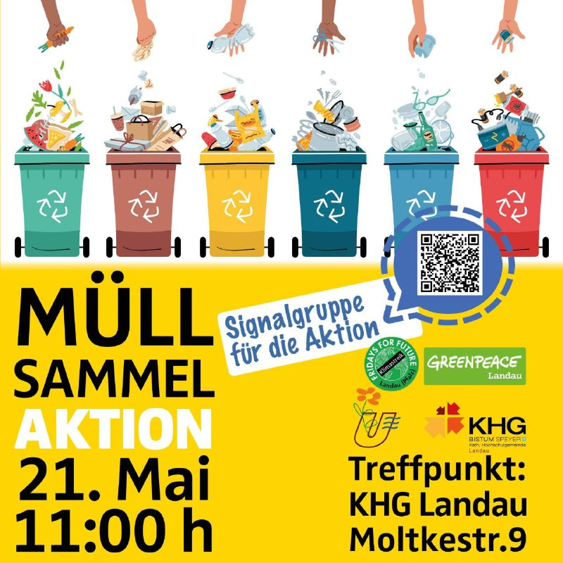

Am 21.5. gibt es eine Müllsammelaktion in Zusammenarbeit von Greenpeace Landau, der KHG, Klimastreiklandau und der Umweltgruppe Landau!
Wir freuen uns riesig über alle, die mit anpacken!  

Treffpunkt ist:  
🗓   21.05  
🕚  um 11:00 Uhr  
📍   an der KHG (Molktestr. 9)  

Dort teilen wir dann die Gruppen und Bezirke auf und los geht´s. 
Wir haben einige Greifzangen und Handschuhe da. Gerne aber auch eigendes Equipment mitbringen.

Bitte auf jeden Fall an den Sonnenschutz denken (wir hoffen mal, dass das Wetter schön wird:) und etwas zum Trinken mitnehmen! 

Wir freuen uns auf die gemeinsame Aktion!
