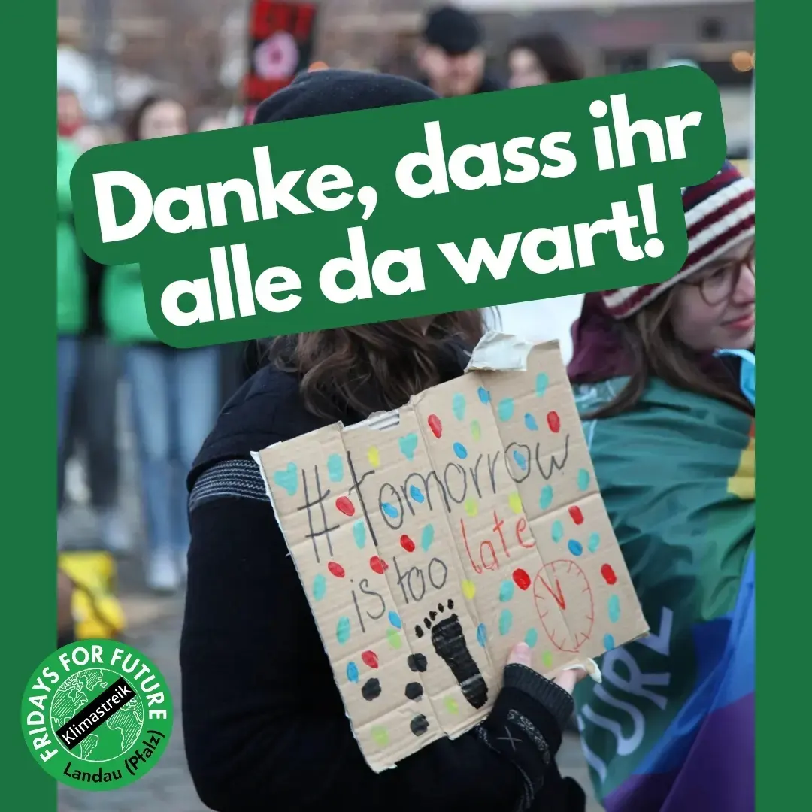

Am 03.03 fand der globale Klimastreik statt und wir haben uns als Bevölkerung in Landau versammelt, um für mehr Klimaschutz zu demonstrieren. Wir waren knapp über 400 Menschen und es war großartig zu sehen, wie viele Menschen sich für die Rettung unseres Planeten eingesetzt haben.

Unser Programm war vielfältig und wurde von den Bands Caravel und Clara, Lovisa, Sette, Henrike gestaltet. Auch der Poetry Slam von Rune und die Reden von Anna und Jan waren sehr gut und haben uns inspiriert.

Wir haben bewusst später angefangen, um auch arbeitenden Menschen die Möglichkeit zu geben, sich uns anzuschließen und für den Klimaschutz zu demonstrieren. Unser Programm begann um 16 Uhr auf der Bühne auf dem Rathausplatz und um 17:45 Uhr sind wir dann als Demo losgelaufen, um unsere Forderungen lautstark zum Ausdruck zu bringen.

Bei gutem Wetter sind wir als Gemeinschaft durch Landau gelaufen und haben uns für eine bessere Zukunft eingesetzt. Es war ein beeindruckendes Bild, wie viele Menschen sich für den Klimaschutz engagiert haben.

Leider gab es zeitliche Verspätungen im Programm, aber wir haben das als Feedback für die nächste Veranstaltung mitgenommen und werden unser Bestes geben, um das nächste Mal noch besser zu planen.

Wir möchten uns bei allen bedanken, die daran teilgenommen haben. 💚 Es ist großartig zu sehen, wie viele Menschen sich für den Klimaschutz einsetzen und wie wichtig ihnen die Zukunft unseres Planeten ist. Wir hoffen, dass dieser Tag dazu beigetragen hat, das Bewusstsein für die Bedeutung des Klimaschutzes zu stärken und dass sich noch mehr Menschen uns beim nächsten Mal anschließen werden.

Ein paar Einblicke der Demo:


