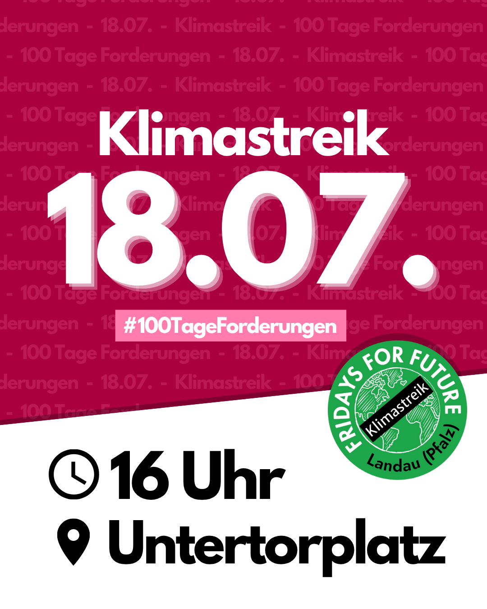
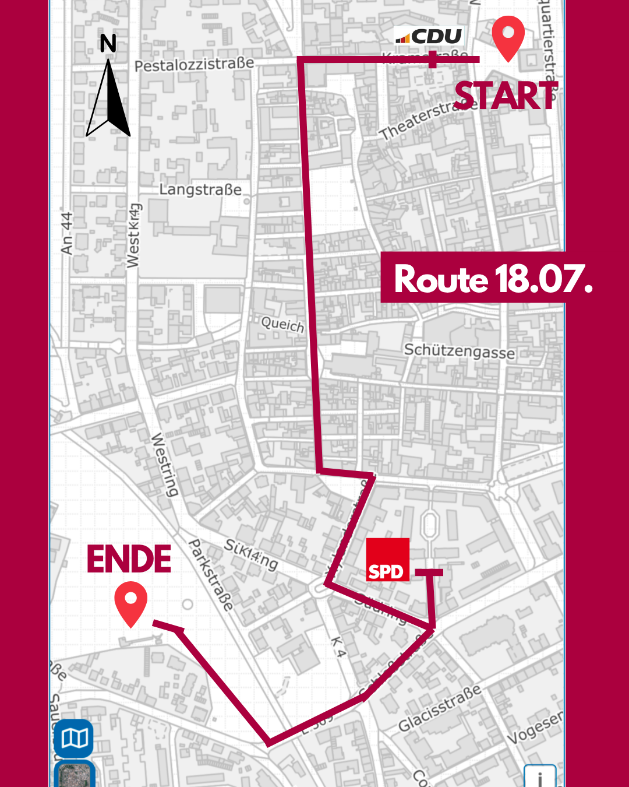

🗓️ <b>18.07.2025</b>   
🕒 <b>um 16:00 Uhr</b>  
📍 auf dem <b>Untertorplatz</b>  

Anfang Mai 2025. In Deutschland brennen Wälder, Böden trocknen aus, Wasser wird knapp. Die Klimakrise eskaliert – mit immer neuen Temperaturrekorden und Extremwetter weltweit. Diese Realität bedroht nicht nur unsere Gesundheit, unsere Umwelt und unsere Zukunft – sie gefährdet auch soziale Sicherheit und wirtschaftliche Stabilität.  

Was wir erwarten, ist das Mindeste: Eine Regierung, die unsere Lebensgrundlagen schützt. Doch statt entschlossenem Handeln plant die neue Koalition aus Union und SPD, Klimaschutzmaßnahmen zurückzunehmen – und das mitten in der Krise. Damit gefährdet sie das, was uns alle trägt.  

In den ersten 100 Tagen ihrer Amtszeit muss diese Regierung zeigen, dass sie der physikalischen, sozialen und wirtschaftlichen Realität der Klimakrise gerecht wird, und mit folgenden schnellen Maßnahmen einlenken:  

<b> Stärkung des Klimaschutzgesetzes: </b> Es braucht einen klaren und verbindlichen Plan, wie die Emissionen in Deutschland gesenkt werden. Dafür muss das Klimaschutzgesetz wieder gestärkt und die verbindlichen Sektorziele wieder eingeführt werden. Bei Verfehlung von Klimazielen muss nachgeschärft statt einfach abgewartet werden. Wilde Gedankenspiele zur Verlagerung von Klimaschutz ins Ausland dürfen nicht Realität werden.  
<b> Konsequente Energiewende: </b> Es braucht  einen entschlossenen Plan für den Gasausstieg bis 2035 und die sofortige Überarbeitung der Kraftwerksstrategie hin zu 100% Erneuerbaren. Allen fossilen Projekten müssen Union und SPD eine klare Absage erteilen.  
<b> Sofortprogramme für die Sektoren Verkehr und Gebäude: </b> Gerade scheitern die deutschen Klimaziele vor allem an dreckigen Heizungen und zu vielen Autos. Hier braucht es schnelle, wirksame Maßnahmen, um einzulenken: unter anderem eine sozial gerechte Novellierung des Gebäudeenergiegesetzes (GEG), ein dauerhaft bezahlbares Deutschlandticket, massiven Ausbau der Bahn-Infrastruktur und die ersatzlose Abschaffung von klimaschädlichen Subventionen wie der Pendlerpauschale.  

Es ist klar, was es jetzt braucht. Doch wir wissen auch, ohne unseren Druck, wird Merz und seine Regierung weder in den nächsten 100 Tagen noch in den nächsten Jahren ausreichend Klimaschutz umsetzen. Deswegen werden wir laut und werden in den ersten 100 Tagen der neuen Regierung 100 Aktionen organisieren.  

<h2> Route </h2>

<h2> Programm </h2>
16:00 Demostart  
16:00 Rede Santiago  
16:15 Rede FFF vor CDU Zukunftsbüro  
Demozug  
16:45 Rede FFF vor SPD Büro  
17:30 Ende im Goethepark 
<ul>
  <li>entspannter Ausklang mit Band und Kuchen</li>
</ul>
