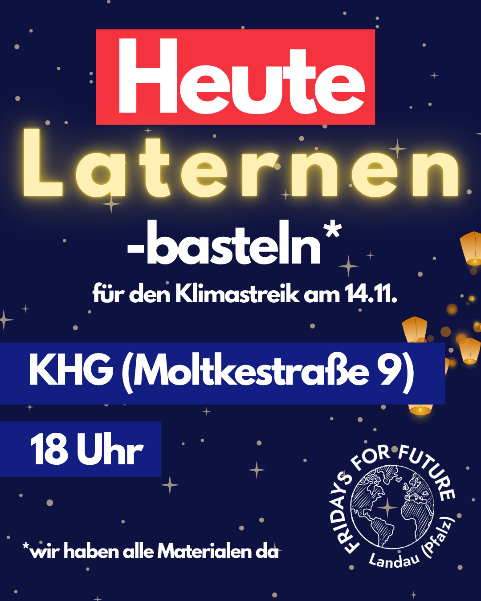
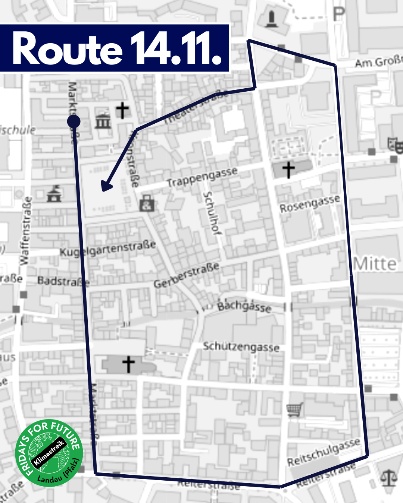

🗓️ <b>14.11.2025</b>   
🕒 <b>um 17:30 Uhr</b>  
📍 <b>Thomas-Nast Platz</b> (Rote Kaserne) 

Die Klimakrise schreitet unaufhörlich vorran! 7 von 9 Kippunkte sind bereits überschritten. Gerade erst wurde bekannt, dass sich das Great Barrier Reaf wohl nicht erhohlen kann. Schon 2050 könnten wir einen Temperaturanstieg von 3-Grad verzeichnen. 
Gleichzeitig wird in der Bundesregierung über neue Gaskraftwerke und die Abschaffung des Verbrenner aus diskutiert und auf EU Ebene eine Abschwächung der Klimaziele beschlossen.  
Die nicht Umsetzung von wirksamer Klimapolitk hat existenzielle Folgen für Menschen weltweit. Sie verlieren durch Dürre, Hochwasser und Ernteausfällen ihre Lebensgrundlage. Auch in Deutschland.  
10 Jahre nach Paris braucht es endlich wirksame Klimapolitik, die die Menschen entlastet, die am stärksten von der Klimakrise betroffen sind.  

Desswegen wollen wir gemeinsam auf die Straße gehen! Am 14.11. um 17:30 Uhr an der Roten Kaseren   
Für eine Energiewende weg von fossilen Energien!   
Für eine Verkehrswende, die auf Menschen und nicht auf Autos setzt.   
Für eine Welt auf der Menschen keine Angst haben müssen ihre Existenz zu verlieren   
Für eine Klimagerechte Zukunft!   

<h2> Laternen </h2>

Da die Demo eine Laternendemo ist, bitten wir euch alle eine Laterne mitzubringen. Wenn ihr keine habt, kommt gerne zum Laternen-Basteln am 06.11. um 18 Uhr in die Molktestraße 9. Wir haben alle Materialen da zum basteln - du musst also nur vorbei kommen :)  

🏮 Falls ihr keine Laterne habt, dann bringt gerne eine Taschenlampe oder euer Handy mit. Wir haben buntes Papier für buntes Licht.

 
 
 
 
 
 
 
 
 
 

<h2> Route </h2>

<h2> Demosprüche </h2>
Paris, Paris - zehn Jahre her! Ihr redet viel wir wollen mehr  
 
A - allé - Alle für das Klima!  
 
Klima - Krise - keine - Zeit  
Handeln müsst ihr jetzt weltweit!  
 
Wir sind hier, wir sind viele, haltet euch an Klimaziele  
 
Unserer Zukunft abgewandt, fährt die Regierung an die Wand  
 
Was ich wirklich gerne hätte,  
Autofreie Innnenstädte!  
Was wünsche ich mir noch viel mehr?  
Kostenlosen Nahrverkehr  
 
Was wir wollen ist nicht schwer,  
Aus Worten sollen Taten her!  
Was wir wollen hört gut her,  
Pariser Ziele jetzt und hier!  
 
Gaskonzerne - bohren in der Ferne. Zerstören unre Umwelt - nur für nen Batzen Geld - Worin wir unsre Zukunft sehen? - Erneuerbare Energien!  
 
1,2,3,4  
Alle Robben bleiben hier  
5,6,7,8  
LNG wird platt gemacht  
9 und 10  
der Wiederstand muss weitergehen  
 
100 Milliarden,  
für Klimamaßnahmen,  
statt neuen Gaskraftwerken,  
Wind nd Sonne stärken.  
Wir wollen alle fahren.  
mit ausgebauten Bahnen,  
statt Geldern für die Gaslobby,  
Erneuerbare Energie,  
Wovon brauchen wir viel mehr?  
Vom öffentlichen Nahverkehr!  
 

<b>Lieder</b>  
Auf den Strassen, auf und nieder  
Auf den Strassen, immer wieder, gegen Nazis für das Klima  
Alte, Junge, coole Leute, sind auf dieser Demo heute.  
(/Alte, junge, alle Leute, kommt auf diese Demo heute!)  
 
Was wir wirklich super fänden, wär die Energie zu wenden  
Wasser, Windkraft und auch Sonne, hauen Kohle in die Tonne.  
 
Ihr könnt uns jetzt nichts vorschreiben, Alle Dörfer müssen bleiben  
hört auf Bäume abzuroden lasst die Kohle doch im Boden  
 
_____________ 
 
Sankt Martin, Sankt Martin, Sankt Martin ritt durch Schnee und Eis...  
 
Erderwäärmung,  
Erderwäärmung,  
Erderwäärmung ist schon längst viel zu hoch,1,5° ist längst erreicht doch Friedrich, deem scheint's eegal, der setzt auf Wirtschaftswaachstum/ der schiebt lieber die Leute ab  
 
gereecht,  
gereecht,  
gerecht sollte's hier zuulaaufen,doch was wir seh'n, sind Krieg treibende, die denken, ihnen gehört die Welt und nicht achten auf Toote.  
 
Im Boden,  
Im Boden,  
Im Boden soll es bleiben, all die Kohle, das Öl und das Gas, lasst's im Boden, verdammt nochmal,lasst's im Boden verdammt noch-maal  
 
Faschisten,  
Faschisten,  
Faschisten haben drei Buchstaben, in Deutschland sind es neuerdings ein A ein F und ein D und wir tun mal noch ein FCK da-vor.  
 
__________  
 
Ich gehe mit meiner Laterne  
und meine Laterne mit mir.  
Für´s Klima streiken wir gerne,  
und darum sind wir hier.  
|: Die Erd´ wird warm, nun gibt´s Alarm. Rabimmel, Rabammel, Rabumm. :|  
(...) |: Der Klimawandel zieht voran. Rabimmel, Rabammel, Rabumm. :|  
(...) |: Ein Vöglein singt, doch bald verklingt. Rabimmel, Rabammel, Rabumm. :|  
(...) |: Ein Kohleduft liegt in der Luft. Rabimmel, Rabammel, Rabumm. :|  
(...) |: Ich sag es schlicht, es reicht noch nicht. Rabimmel, Rabammel, Rabumm. :|  
(...) |: Streikt mit uns heut, Ihr lieben Leut. Rabimmel, Rabammel, Rabumm. :|  
(...) |: Nun lasst uns gehn, man wird uns sehn. Rabimmel, Rabammel, Rabumm. :|  
(...) |: Mein Schild nehm ich, so stoppt mich nicht. Rabimmel, Rabammel, Rabumm. :|  
(...) |: Wir zeigen Mut, bis ihr was tut. Rabimmel, Rabammel, Rabumm. :  
 
______________  
 
Laterne, Laterne, wir lieben uns're Erde  
 
Laterne, Laterne, wir lieben uns're Erde.  
Brenne auf, mein Licht, brenne auf, mein Licht,  
aber nur meine liebe Erde nicht.  
 
Laterne, Laterne, wir lieben uns're Erde.  
Wenn es zu spät ist, wenn es zu spät ist,  
Ja, dann seht ihr erst, wie schlimm es ist.  
 
Laterne, Laterne, wir lieben uns're Erde.  
Geh nicht weg mein Licht, geh nicht weg mein Licht,  
Denn mit dir stirbt unsre Hoffnung nicht.  
 
Laterne, Laterne, wir lieben uns're Erde.  
Und die Winde wehn, und die Winde wehn,  
Lassen die Windräder immer weiterdreh'n.  
 
Laterne, Laterne, wir lieben uns're Erde.  
Und der Sonnenschein, und der Sonnenschein,  
bringt uns grüne Energie ins Heim.  
 
_________________  
 
Hanging Tree - Tribute von Panem  
[Alles tief]  
Bist du, bist du,  
mit auf der Straße heut’?  
 
Wo die Herzen brenn',  
im kampf für unsre welt.  
 
Wir haben viel erreicht,  
doch noch mehr bleibt zu tun.  
 
Wir sehn die Welt,  
und dass sie brennen kann.  
 
[Alles hoch]  
Bist du, bist du,  
mit auf der Demo heut'?  
 
Wo die Stimmen laut,  
und uns’re Hoffnung frei.  
 
Sie wollen's ignoriern',  
doch wir sind alle da —  
 
Wir sehn die Welt,  
und wer sie retten kann.  

